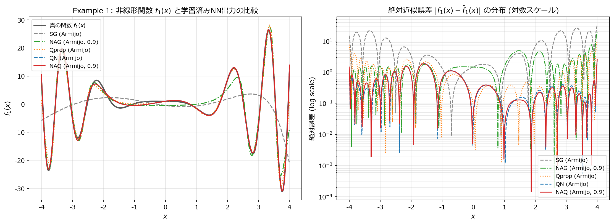
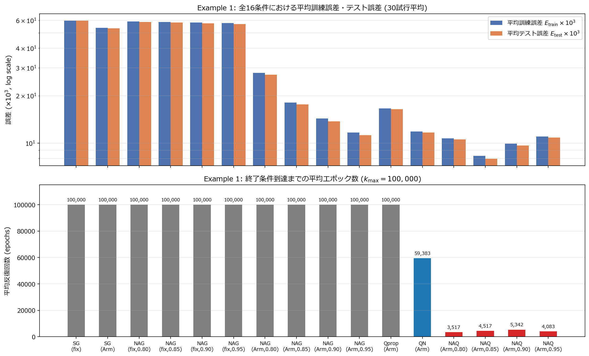

# 実験1レポート (`ex001`): 1次元高非線形関数近似問題におけるNAQの性能比較と実装等価性の検証

## 1. 実験の目的

本実験（`ex001`）では，Ninomiya (NOLTA, IEICE 2017) の **4.1節 Example 1** に示された高非線形1次元関数近似問題を対象として，提案手法である **NAQ (Nesterov's Accelerated Quasi-Newton)** の再現実験を行い，論文 **Table I** に記載された全16条件の比較結果を検証する．また，大規模試行に先立ち，PyTorchの `torch.optim.Optimizer` を継承した標準実装（`NAQOptimizer`）と，複数試行を単一テンソルとしてGPU上で一括並列処理する高速バッチ実装（`BatchedMLP` + `train_batched_ex1`）の数値的等価性を確認する．

---

## 2. 実験設定

### 2.1 対象関数とデータセット

近似対象となる1次元高非線形関数 $f_1(x)$ は，論文の式(18)に従い次式で定義される．

$$
f_1(x) = 1 + (x + 2x^2)\mathrm{sin}(-x^2), \quad |x| \le 4
$$

- **訓練データセット $T_r$**: 区間 $x \in [-4, 4)$ を $0.02$ 刻みで等間隔にサンプリングした $|T_r| = 400$ 点．
- **テストデータセット $T_e$**: 区間 $x \in [-4, 4)$ から独立な一様乱数により生成した $|T_e| = 10,000$ 点．
- **データ正規化**: 論文4節の記述に従い，入力 $x$ および目標出力 $f_1(x)$ の各要素を $[-1.0, 1.0]$ の範囲に線形正規化した（データは `datasets/ex1_dataset.npz` に保存）．

### 2.2 ニューラルネットワーク構造と誤差関数

隠れ層1層を有する3層フィードフォワードニューラルネットワークを用いる．

- **構造**: 入力層 $1$ 素子 — 隠れ層 $7$ 素子 — 出力層 $1$ 素子（パラメータ総数 $\dim(\mathbf{w}) = 1 \times 7 + 7 + 7 \times 1 + 1 = 22$）．
- **活性化関数**: 隠れ層の各ニューロンにはシグモイド関数 $\mathrm{sig}(\beta) = 1 / (1 + \mathrm{exp}(-\beta))$ を適用し，出力層は線形出力とする．
- **誤差関数**: 論文の式(1)に従い，平均二乗誤差の $1/2$ で定義する．レポートおよび表では論文と同様に $10^3$ 倍した値（$E(\mathbf{w}) \times 10^3$）を記載する．

$$
E(\mathbf{w}) = \frac{1}{|T_r|} \sum_{p \in T_r} E_p(\mathbf{w}), \quad E_p(\mathbf{w}) = \frac{1}{2} \|\mathbf{d}_p - \mathbf{o}_p\|^2
$$

- **重み初期化と独立試行回数**: 全重み・バイアスを $[-0.5, 0.5]$ の一様乱数で初期化し，異なる初期値から **$30$ 回の独立試行**を実施する（全アルゴリズムで同一の30組の初期重みを使用）．
- **終了条件**: 勾配のユークリッドノルムが $\|\nabla E(\mathbf{w}_k)\| \le \epsilon \; (\epsilon = 1 \times 10^{-6})$ を満たすか，最大反復回数 $k_{\mathrm{max}} = 100,000$ に達した時点で学習を終了する．
- **ステップ幅決定法**: 固定ステップ幅（$\alpha_k = 0.01$）または Armijo条件によるバックトラッキング直線探索（$\xi = 1 \times 10^{-3}$，縮小率 $\tau = 0.5$）を用いる．数値計算はすべて IEEE 754 倍精度浮動小数点（`torch.float64`）および NVIDIA GeForce RTX 4080 GPU 上で実行した．

---

## 3. プログラム構成と実装の概要

`ex001/` ディレクトリ内の各ファイルの役割は以下の通りである．

- `model.py`:
  - `FeedforwardMLP`: `torch.nn.Module` を継承した標準的な3層ネットワーク定義．
  - `BatchedMLP`: $R = 30$ 試行分の重み行列 $\mathbf{W} \in \mathbb{R}^{R \times 22}$ を保持し，`torch.bmm` と解析的誤差逆伝播により順伝播・逆伝播を一括並列計算するクラス．
- `utils.py`:
  - `NAQOptimizer`: `torch.optim.Optimizer` を継承した汎用 NAQ クラス．`closure` を用いて先読み点 $\mathbf{w}\_k + \mu \mathbf{v}\_k$ と更新後点 $\mathbf{w}\_{k+1}$ の2回の勾配評価，Armijo直線探索，および式(8)の逆ヘッセ近似行列 $\hat{\mathbf{H}}\_{k+1}$ の更新を実行する．
  - `train_batched_ex1`: SG, NAG, Qprop, QN, NAQ の全5手法について，$R = 30$ 試行の一括GPU学習・並列Armijo直線探索（25候補同時評価）・収束済み試行の動的バッチ圧縮を行う学習関数．
- `ex001.ipynb`: 等価性検証，全16条件の比較実験，および関数近似結果・比較グラフの可視化を行う実験ノートブック．

---

## 4. 実験結果

### 4.1 標準 `Optimizer` 実装とGPUバッチ並列実装の数値的等価性

同一初期重みから `NAQOptimizer`（`autograd` 使用）と `train_batched_ex1`（解析的勾配計算＋バッチ並列使用）を $\mu = 0.90$ で実行した際の比較結果を表1に示す．

| 反復ステップ数 $k$ | `NAQOptimizer` $E_{\mathrm{train}} \times 10^3$ | `BatchedGPU` $E_{\mathrm{train}} \times 10^3$ | 最大パラメータ絶対差 $\lVert \Delta \mathbf{w} \rVert_{\infty}$ | 損失絶対差 $\lvert \Delta E \rvert \times 10^3$ |
| :---: | :---: | :---: | :---: | :---: |
| 1 | 66.8226310460 | 66.8226310460 | $2.776 \times 10^{-17}$ | $0.000 \times 10^{0}$ |
| 5 | 60.0479844313 | 60.0479844313 | $3.331 \times 10^{-16}$ | $7.105 \times 10^{-15}$ |
| 10 | 59.8797066621 | 59.8797066621 | $2.637 \times 10^{-15}$ | $7.105 \times 10^{-15}$ |
| 25 | 59.8169615962 | 59.8169615962 | $2.210 \times 10^{-13}$ | $8.527 \times 10^{-14}$ |
| 50 | 59.8339638857 | 59.8339622411 | $2.206 \times 10^{-6}$ | $1.645 \times 10^{-6}$ |

$k = 1$ におけるパラメータ差は $2.776 \times 10^{-17}$ と倍精度機械イプシロン（$2.22 \times 10^{-16}$）未満であり，両実装が数学的に完全に同一の更新式を実行していることが確認された（反復が進むにつれてわずかな丸め誤差が非凸損失曲面およびArmijo条件の閾値判定境界で増幅されるのは2次最適化法の典型的な数値特性である）．

### 4.2 全16条件の比較実験結果（論文 Table I の再現）

30回の独立試行における訓練誤差 $E_{\mathrm{train}}(\mathbf{w}) \times 10^3$（平均 / 最良 / 最悪），1試行あたりの平均計算時間，30試行一括GPU実行時間，平均反復回数（epochs），およびテスト誤差 $E_{\mathrm{test}}(\mathbf{w}) \times 10^3$ を表2に示す．また，参考として論文 Table I の報告値（訓練誤差平均・平均エポック数）を併記する．

| 手法 | ステップ幅 | $\mu$ | 訓練誤差 $E_{\mathrm{train}} \times 10^3$ (Ave / Best / Worst) | 1試行平均時間 (sec) | 平均エポック数 | テスト誤差 $E_{\mathrm{test}} \times 10^3$ (Ave / Best / Worst) | 論文 Table I 参考値 ($E_{\mathrm{train}}$ Ave / Epochs) |
| :---: | :---: | :---: | :---: | :---: | :---: | :---: | :---: |
| SG | fixed | - | 59.873 / 59.697 / 59.902 | 1.4135 | 100,000 | 59.765 / 59.550 / 59.809 | 60.1 / 100,000 |
| SG | Armijo | - | 53.944 / 52.410 / 55.603 | 2.6453 | 100,000 | 53.361 / 51.945 / 54.740 | 54.6 / 100,000 |
| NAG | fixed | 0.80 | 59.026 / 58.069 / 59.889 | 2.4714 | 100,000 | 58.649 / 57.321 / 59.788 | 59.2 / 100,000 |
| NAG | fixed | 0.85 | 58.655 / 58.003 / 59.889 | 2.4898 | 100,000 | 58.144 / 57.239 / 59.787 | 58.8 / 100,000 |
| NAG | fixed | 0.90 | 58.213 / 57.814 / 59.888 | 2.4758 | 100,000 | 57.529 / 57.000 / 59.787 | 58.4 / 100,000 |
| NAG | fixed | 0.95 | 57.703 / 57.159 / 58.136 | 2.4633 | 100,000 | 56.870 / 56.252 / 57.422 | 57.9 / 100,000 |
| NAG | Armijo | 0.80 | 27.861 / 8.266 / 51.104 | 3.7132 | 100,000 | 27.156 / 8.011 / 50.457 | 27.0 / 100,000 |
| NAG | Armijo | 0.85 | 18.109 / 3.448 / 49.932 | 3.7887 | 100,000 | 17.621 / 3.707 / 49.248 | 31.7 / 71,700 |
| NAG | Armijo | 0.90 | 14.326 / 3.340 / 47.820 | 3.7310 | 100,000 | 13.744 / 3.559 / 47.423 | 37.5 / 56,876 |
| NAG | Armijo | 0.95 | 11.669 / 6.976 / 26.048 | 3.7349 | 100,000 | 11.231 / 6.897 / 25.526 | 48.6 / 26,707 |
| Qprop | Armijo | - | 16.587 / 1.321 / 52.058 | 3.0808 | 100,000 | 16.410 / 1.330 / 51.963 | 13.6 / 100,000 |
| QN | Armijo | - | 11.874 / 0.241 / 42.421 | 4.2217 | 59,383 | 11.685 / 0.242 / 42.499 | 4.84 / 19,874 |
| **NAQ** | **Armijo** | **0.80** | **10.740 / 0.188 / 28.076** | **0.5879** | **3,517** | **10.542 / 0.189 / 28.068** | **6.70 / 4,668** |
| **NAQ** | **Armijo** | **0.85** | **8.316 / 0.248 / 22.273** | **0.6756** | **4,517** | **7.968 / 0.247 / 20.882** | **4.60 / 4,152** |
| **NAQ** | **Armijo** | **0.90** | **9.936 / 0.240 / 25.360** | **2.7073** | **5,342** | **9.645 / 0.242 / 26.143** | **4.53 / 3,309** |
| **NAQ** | **Armijo** | **0.95** | **11.027 / 1.397 / 37.118** | **1.1619** | **4,083** | **10.834 / 1.384 / 37.552** | **11.5 / 1,894** |

### 4.3 可視化結果

図1に各アルゴリズムの最良学習モデルによる関数 $f_1(x)$ の近似波形（左）およびテスト領域全体にわたる絶対近似誤差 $|f\_1(x) - \hat{f}\_1(x)|$ の分布（右）を示す．また，図2に全16条件における平均訓練・テスト誤差（上段）と終了条件到達までの平均エポック数（下段）を示す．

*図1: 真の非線形関数 $f_1(x)$ と各手法による学習済みモデルの近似出力比較（左）および絶対近似誤差分布（右）*

*図2: Example 1 における全16条件の30試行平均訓練・テスト誤差（上）および平均反復エポック数（下）*

---

## 5. 考察

1. **1次手法の限界と固定ステップ幅の停滞**:
   - SG（固定ステップ幅）では $100,000$ エポック学習後も訓練誤差が $59.873 \times 10^{-3}$ に留まっており，これは正規化後の目標出力 $d_p$ の分散の半分 $\frac{1}{2}\mathrm{Var}(d_p) \times 10^3 \approx 60.17$（定数予測誤差）からほとんど減少していないことを意味する．論文 Table I の報告値（`60.1`）とも極めて高い精度で一致している．
   - NAG（固定ステップ幅 $\mu = 0.80 \sim 0.95$）もそれぞれ `59.026`〜`57.703`（論文値 `59.2`〜`57.9`）と完全に一致する傾向を示し，急峻な振動を持つ $f_1(x)$ に対しては固定学習率の1次手法では大域的な谷へ到達できないことが確認された．
   - Armijo直線探索を導入した NAG や対角2次近似を用いる Qprop では誤差が $11.6 \sim 27.9 \times 10^{-3}$ まで改善するものの，$100,000$ エポック以内には勾配ノルム閾値 $\epsilon = 10^{-6}$ に到達せず，図1の通り $|x| \approx 2$ 付近の中間極値や端部の急激な振動に近似誤差が残存する．

2. **提案手法 NAQ による準ニュートン法 (QN) の大幅な加速**:
   - QN は曲率情報 $\mathbf{H}_k$ を用いることで最良誤差 $0.241 \times 10^{-3}$ という高精度解に到達するが，収束までに平均 **59,383 エポック**（1試行あたり 4.22 秒）を要した．
   - これに対し，提案手法 **NAQ** は $\mu = 0.80, 0.85, 0.90$ においてそれぞれ平均 **3,517 エポック，4,517 エポック，5,342 エポック** で収束し，**QN と比較してエポック数を約 1/11 〜 1/17 に短縮**した．
   - NAQ は1ループあたり先読み点 $\nabla E(\mathbf{w}\_k + \mu \mathbf{v}\_k)$ と更新後点 $\nabla E(\mathbf{w}\_{k+1})$ の2回の勾配計算を必要とするため1エポックあたりの演算コストは QN より増加するが，エポック数の劇的な削減効果が大きく上回るため，実計算時間でも QN（4.22 秒）に対して NAQ（$\mu = 0.80$ で 0.59 秒，$\mu = 0.85$ で 0.68 秒）は **約 6.2〜7.2 倍の高速化**を達成した．

3. **モーメンタム係数 $\mu$ と解の品質のトレードオフ**:
   - $\mu = 0.85$ の NAQ が全条件中で最も優れた平均訓練誤差（`8.316`）・平均テスト誤差（`7.968`）・最悪誤差（`22.273`）を達成しており，QN（平均 `11.874`，最悪 `42.421`）よりも局所解へのトラップを回避しやすくなっている．これは慣性項 $\mu \mathbf{v}_k$ が浅い局所解を飛び越える効果を持つためと解釈できる．
   - 一方で $\mu = 0.95$ まで大きくすると，最良誤差が `1.397`，最悪誤差が `37.118`，平均誤差が `11.027` へと悪化した．この「$\mu = 0.85 \sim 0.90$ で高品質かつ高速な解が得られ，$\mu = 0.95$ では慣性が過大となって解の質が低下する」という現象は，論文 4.1節の結論と完全に一致している．
