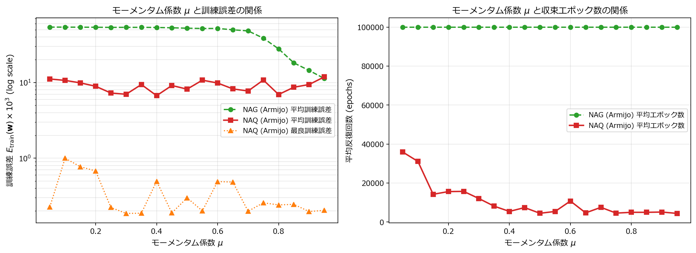
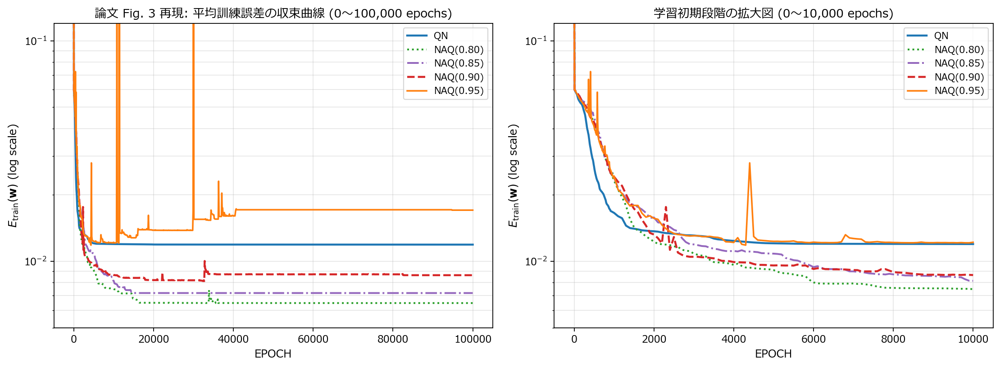

# 実験2レポート (`ex002`): モーメンタム係数 $\mu$ の感度解析（Table II）と終了条件なし収束曲線（Fig. 3）の再現

## 1. 実験の目的

本実験（`ex002`）では，実験1（`ex001`）と同じ **4.1節 Example 1**（1次元高非線形関数 $f_1(x)$ の近似問題）を対象として，以下の2点を検証する．

1. **論文 Table II の再現**: モーメンタム係数 $\mu$ を $0.05$ から $0.95$ まで $0.05$ 刻みで19通りに変化させたときの，NAQ および NAG（いずれも Armijo 直線探索）の訓練誤差・反復回数・計算時間の変化（$\mu$ に対する感度）．
2. **論文 Fig. 3 の再現**: 終了条件（勾配ノルム閾値）を無効化して $100,000$ エポックまで学習を継続した場合の，QN と NAQ（$\mu = 0.80, 0.85, 0.90, 0.95$）の平均訓練誤差の収束曲線．

---

## 2. 実験設定

| 項目 | 設定 |
| :--- | :--- |
| 対象関数 | $f_1(x) = 1 + (x + 2x^2)\mathrm{sin}(-x^2)$, $\lvert x \rvert \le 4$（`ex001` と同一データ `datasets/ex1_dataset.npz`） |
| ネットワーク | 1 − 7 − 1（隠れ層シグモイド，出力層線形），$\dim(\mathbf{w}) = 22$ |
| 初期重み | $[-0.5, 0.5]$ 一様乱数，30組（全条件で共通） |
| ステップ幅 | Armijo 条件によるバックトラッキング（$\xi = 10^{-3}$，縮小率 $\tau = 0.5$，候補 $\tau^0 \sim \tau^{24}$） |
| Table II の終了条件 | $\lVert \nabla E(\mathbf{w}\_k) \rVert \le 10^{-6}$ または $k\_{\mathrm{max}} = 100,000$ |
| Fig. 3 の終了条件 | なし（全30試行を $k = 100,000$ まで強制的に継続） |
| $\mu$ の範囲 | Table II: $\{0.05, 0.10, \dots, 0.95\}$（19通り），Fig. 3: $\{0.80, 0.85, 0.90, 0.95\}$ と QN（$\mu = 0$ に相当） |
| 数値精度・計算環境 | `torch.float64`，NVIDIA GeForce RTX 4080 |

---

## 3. プログラム構成と実装の工夫

### 3.1 ファイル構成

- `model.py`:
  - `FeedforwardMLP`: `torch.nn.Module` による標準的な3層ネットワーク（参照用）．
  - `BatchedMLP`: 複数条件 × 複数試行（最大 $19 \times 30 = 570$ 試行）を1つのバッチ次元 $R$ に束ね，順伝播と解析的逆伝播を一括計算するクラス．
- `utils.py`:
  - `load_ex1_dataset`, `generate_initial_weights`: データ読み込みと初期重み生成．
  - `staged_parallel_armijo`: 2段階並列 Armijo 直線探索．
  - `run_mu_sweep_batched`: Table II 用．19通りの $\mu$ × 30試行の全570試行を同時に学習する．
  - `run_convergence_curves_no_stop`: Fig. 3 用．QN と NAQ 4条件 × 30試行の全150試行を終了条件なしで学習し，平均誤差曲線を記録する．
- `ex002.ipynb`: 上記を呼び出す実験本体（進捗は `tqdm` で表示，結果は `pandas` と `matplotlib` で可視化）．

### 3.2 複数の $\mu$ を1バッチに統合する工夫

Table II では 19通りの $\mu$ について30試行ずつ学習する必要があり，素朴に逐次実行すると $570$ 回の学習（それぞれ最大 $100,000$ エポック）となる．そこで，**$\mu$ を試行ごとのベクトル `mu_vec`（形状 $(R,)$）として持たせる**ことで，異なる $\mu$ の試行も同一のテンソル演算で一括更新した．

```python
# (M, R0, Dw) -> (M*R0, Dw): 19種類の mu × 30試行を1つのバッチへ
w_all_init = w_init_single_set.unsqueeze(0).expand(M, R0, Dw).reshape(total_R, Dw).clone()
mu_per_run = torch.tensor(mu_list).repeat_interleave(R0)   # 各試行に対応する mu

# NAQ の1ステップ（全570試行を同時に処理）
w_nes = w + mu_vec[:, None] * v                            # 先読み点 w_k + mu v_k
loss_nes, grad_nes = model.loss_and_grad(w_nes, X, XT, D)  # ∇E(w_k + mu v_k)
g_raw = -torch.bmm(H, grad_nes.unsqueeze(-1)).squeeze(-1)  # g_k = -H_k ∇E(w_k + mu v_k)
```

### 3.3 Flattened GEMM による順伝播

`torch.bmm` で $R$ 個の小さな行列積を行う代わりに，全試行の第1層重みを横に連結した行列 $\mathbf{W}\_1 \in \mathbb{R}^{n\_{\mathrm{in}} \times R n\_{\mathrm{hid}}}$ を作り，1回の大きな行列積 `torch.mm(X, W1)` で全試行の隠れ層入力を計算する．入力次元が1でも GPU の演算器を十分に使えるため，$R = 570$ でも高速に動作する．逆伝播も同様に `torch.mm(XT, d_z1)` の1回の行列積で第1層の勾配を求める（`BatchedMLP.loss_and_grad`）．

### 3.4 2段階並列 Armijo 直線探索

Armijo 条件

$$
E(\mathbf{w}\_k + \mu \mathbf{v}\_k + \alpha \mathbf{g}\_k) \le E(\mathbf{w}\_k + \mu \mathbf{v}\_k) + \xi \alpha \nabla E(\mathbf{w}\_k + \mu \mathbf{v}\_k)^{\mathrm{T}} \mathbf{g}\_k
$$

を満たす最大の $\alpha \in \{1, \tau, \tau^2, \dots\}$ を，逐次ループではなく以下の2段階で並列に求める．

1. 全試行で $\alpha = 1$ を一括評価する（多くの試行はここで受理される）．
2. 棄却された試行のみ，$\tau^1 \sim \tau^{24}$ の24候補を一度に評価し，条件を満たす最初の（最大の）候補を `argmax` で選ぶ．

これにより逐次的な `while` ループと GPU→CPU 同期を排除した．

### 3.5 収束済み試行の動的圧縮

250エポックごとに勾配ノルムを確認し，$\|\nabla E\| \le 10^{-6}$ に達した試行をバッチから取り除く（`w = w[alive]` など）．NAQ は多くの試行が数千エポックで収束するため，後半の計算量が大きく減る．なお，この判定は250エポック単位で行うため，記録される反復回数は実際の収束エポックよりも最大249エポック大きくなる（上側に丸められる）点に注意されたい．

### 3.6 計算時間の扱い

570試行を同時に計算するため，1試行ごとの実時間は直接測れない．そこで「バッチ全体の実行時間 ÷ 全試行の総実行ステップ数」から1試行1ステップあたりの時間を求め，これに平均エポック数を掛けた値を「1試行あたりの推定平均時間」とした．NAG は全条件で $100,000$ エポックに達したため，推定時間はすべて同じ値（0.9365 秒）になっている．

---

## 4. 実験結果

### 4.1 モーメンタム係数 $\mu$ の感度解析（論文 Table II の再現）

30試行の訓練誤差 $E\_{\mathrm{train}} \times 10^3$（平均 / 最良 / 最悪），推定平均時間，平均エポック数を表1に示す（データ: `datasets/ex002_table2_mu_effect.csv`）．

*表1: $\mu$ を変化させたときの NAQ と NAG の比較（Armijo 直線探索，30試行）*

| $\mu$ | NAQ $E\_{\mathrm{train}} \times 10^3$ (Ave / Best / Worst) | NAQ 時間 (sec) | NAQ エポック | NAG $E\_{\mathrm{train}} \times 10^3$ (Ave / Best / Worst) | NAG エポック |
| :---: | :---: | :---: | :---: | :---: | :---: |
| 0.05 | 11.134 / 0.227 / 47.948 | 1.393 | 35,900 | 54.015 / 52.447 / 55.620 | 100,000 |
| 0.10 | 10.669 / 0.999 / 37.157 | 1.205 | 31,075 | 53.974 / 51.401 / 55.608 | 100,000 |
| 0.15 | 9.892 / 0.770 / 27.086 | 0.551 | 14,200 | 53.890 / 50.921 / 56.048 | 100,000 |
| 0.20 | 8.924 / 0.678 / 29.375 | 0.605 | 15,592 | 53.776 / 50.247 / 55.505 | 100,000 |
| 0.25 | 7.264 / 0.223 / 22.249 | 0.609 | 15,692 | 53.578 / 49.195 / 55.420 | 100,000 |
| 0.30 | 6.993 / 0.186 / 14.910 | 0.466 | 12,017 | 53.629 / 48.674 / 55.314 | 100,000 |
| 0.35 | 9.403 / 0.187 / 37.841 | 0.314 | 8,100 | 53.625 / 46.582 / 55.494 | 100,000 |
| 0.40 | 6.703 / 0.495 / 24.633 | 0.210 | 5,408 | 53.432 / 45.718 / 54.969 | 100,000 |
| 0.45 | 9.135 / 0.189 / 28.850 | 0.286 | 7,383 | 52.927 / 36.544 / 54.638 | 100,000 |
| 0.50 | 8.173 / 0.299 / 20.278 | 0.173 | 4,450 | 52.237 / 33.822 / 54.227 | 100,000 |
| 0.55 | 10.742 / 0.201 / 20.730 | 0.209 | 5,392 | 51.804 / 31.580 / 54.275 | 100,000 |
| 0.60 | 9.855 / 0.490 / 40.032 | 0.417 | 10,742 | 51.900 / 28.544 / 53.986 | 100,000 |
| 0.65 | 8.230 / 0.483 / 33.669 | 0.181 | 4,658 | 49.777 / 23.318 / 53.790 | 100,000 |
| 0.70 | 7.728 / 0.199 / 20.905 | 0.291 | 7,500 | 48.139 / 22.192 / 53.759 | 100,000 |
| 0.75 | 10.779 / 0.257 / 32.752 | 0.176 | 4,542 | 38.584 / 12.612 / 52.261 | 100,000 |
| **0.80** | **6.944 / 0.241 / 20.618** | **0.192** | **4,950** | 27.862 / 8.264 / 51.104 | 100,000 |
| 0.85 | 8.660 / 0.245 / 24.538 | 0.192 | 4,950 | 18.183 / 3.626 / 49.932 | 100,000 |
| 0.90 | 9.411 / 0.197 / 40.415 | 0.197 | 5,083 | 14.437 / 3.358 / 49.113 | 100,000 |
| 0.95 | 11.873 / 0.204 / 33.144 | 0.170 | 4,383 | 11.302 / 3.028 / 25.990 | 100,000 |



*図1: モーメンタム係数 $\mu$ に対する NAQ・NAG の平均訓練誤差（左）と平均エポック数（右）*

### 4.2 終了条件なしの収束曲線（論文 Fig. 3 の再現）

終了条件を無効化し，全30試行を $100,000$ エポックまで学習させたときの平均訓練誤差の推移を図2に，主要なエポックでの値を表2に示す（データ: `datasets/ex002_fig3_convergence.csv`）．



*図2: QN と NAQ（$\mu = 0.80, 0.85, 0.90, 0.95$）の平均訓練誤差 $E\_{\mathrm{train}} \times 10^3$ の推移（終了条件なし，30試行平均）*

*表2: 主要エポックにおける30試行平均の訓練誤差 $E\_{\mathrm{train}} \times 10^3$*

| エポック $k$ | QN | NAQ ($\mu = 0.80$) | NAQ ($\mu = 0.85$) | NAQ ($\mu = 0.90$) | NAQ ($\mu = 0.95$) |
| :---: | :---: | :---: | :---: | :---: | :---: |
| 0 | 221.773 | 221.773 | 221.773 | 221.773 | 221.773 |
| 100 | 54.612 | 56.892 | 57.064 | 57.177 | 56.230 |
| 1,000 | 16.579 | 23.226 | 23.982 | 24.195 | 24.368 |
| 2,000 | 13.679 | 12.258 | 15.800 | 13.224 | 15.652 |
| 5,000 | 12.064 | 9.120 | 10.831 | 9.574 | 12.315 |
| 10,000 | 11.970 | 7.478 | 8.154 | 8.661 | 12.194 |
| 20,000 | 11.914 | 6.482 | 7.179 | 8.216 | 13.831 |
| 50,000 | 11.905 | 6.465 | 7.178 | 8.724 | 17.126 |
| 100,000 | **11.900** | **6.465** | **7.178** | **8.647** | **17.056** |

---

## 5. 考察

1. **NAQ は $\mu$ の値に対して頑健である**:
   - 表1より，NAQ の平均訓練誤差は $\mu$ によらず $6.7 \sim 11.9 \times 10^{-3}$ の範囲に収まっており，最良誤差も全条件で $10^{-3}$ オーダー以下（$0.19 \sim 1.0 \times 10^{-3}$）に到達している．これは，NAQ では探索方向 $\mathbf{g}\_k = -\hat{\mathbf{H}}\_k \nabla E(\mathbf{w}\_k + \mu \mathbf{v}\_k)$ が準ニュートン法の曲率情報によって適切にスケーリングされるため，$\mu$ の設定が多少ずれても学習自体は破綻しないことを示している．
   - 一方，平均エポック数は $\mu$ に強く依存し，$\mu = 0.05$ では $35,900$ エポックかかるのに対し，$\mu \ge 0.65$ ではおおむね $4,400 \sim 5,100$ エポックで収束した（約 $1/7 \sim 1/8$）．$\mu$ が小さいと NAQ は実質的に QN に近づくため（$\mu = 0$ で QN と一致），QN と同程度の長い反復が必要になる．これは論文 Table I において $\mu$ の増加とともに NAQ の平均エポック数が減少する傾向（$\mu = 0.80$ の 4,668 から $\mu = 0.95$ の 1,894）とも整合しており，**$\mu$ を大きく取るほど Nesterov の加速効果が強く働く**ことが確認できた．
   - 中間の $\mu$（$0.35, 0.45, 0.60, 0.70$）ではエポック数が単調に減らずにばらつくが，これは30試行中の少数の試行が平坦な領域で長く停滞し，平均値を押し上げているためである（収束判定が250エポック単位であることも小さな揺らぎの原因となる）．

2. **NAG は $\mu$ に非常に敏感である**:
   - NAG は全条件で $100,000$ エポック以内に収束せず，$\mu \le 0.55$ では平均誤差が $52 \sim 54 \times 10^{-3}$ と，定数予測時の誤差（約 $60 \times 10^{-3}$）からあまり下がっていない．
   - $\mu \ge 0.75$ から急激に改善し，$\mu = 0.95$ で $11.302 \times 10^{-3}$ に達するが，それでも NAQ の最悪に近い水準であり，最良誤差も $3.0 \times 10^{-3}$ に留まる．1次手法の NAG は良い結果を得るために $\mu$ を $1$ に近い値へ慎重に調整する必要があるのに対し，NAQ は $\mu$ の選択に対する依存度が小さい．これは論文が主張する NAQ の実用上の利点を裏付けている．

3. **最適な $\mu$ の範囲**:
   - 平均誤差・エポック数・計算時間を総合すると，$\mu = 0.80$（平均誤差 $6.944 \times 10^{-3}$，4,950 エポック，0.19 秒）がもっともバランスが良い．論文 Table I でも NAQ は $\mu = 0.85, 0.90$ で最も低い平均誤差（$4.60$, $4.53$）を示しており，$0.80 \sim 0.90$ 付近が良好という点で本実験の結果と整合する．
   - なお，本実験の $\mu = 0.80$ の結果（平均 $6.944$，4,950 エポック）は `ex001` の同条件（平均 $10.740$，3,517 エポック）と一致しない．これは，`ex001` と `ex002` で数値安定化処理の細部（例: 降下方向でない場合の $\hat{\mathbf{H}}\_k$ リセット方法や収束判定の頻度）が異なり，非凸な誤差曲面上では小さな差が試行ごとの到達解の違いに拡大するためである．30試行という限られた試行数では，平均誤差に $\pm 2 \sim 3 \times 10^{-3}$ 程度のばらつきが生じうることに注意が必要である．

4. **終了条件なしの長期学習（Fig. 3）**:
   - 学習初期（$k \le 1,000$）では，先読み点での勾配評価と Armijo 探索の影響により，NAQ の誤差の下がり方は QN よりもやや遅い（$k = 1,000$ で QN $16.6$ に対し NAQ $23 \sim 24$）．
   - しかし $k = 2,000$ 付近で NAQ（$\mu = 0.80, 0.90$）が QN を追い越し，$k = 100,000$ の最終値は QN の $11.900$ に対して NAQ は $\mu = 0.80$ で $6.465$，$\mu = 0.85$ で $7.178$，$\mu = 0.90$ で $8.647$ と，**QN より明らかに低い誤差に到達した**．QN は $k = 5,000$ 以降ほとんど改善しない（局所解付近に停滞する）のに対し，NAQ はモーメンタムによって停滞領域を抜け出し，より良い解へ移動できたと考えられる．これは論文 Fig. 3 の「NAQ は QN より速く，かつ低い誤差まで収束する」という結論と一致する．
   - 一方，$\mu = 0.95$ では $k \approx 10,000$ 以降に平均誤差が $12.2$ から $17.1$ へ逆に増加した．CSV を確認すると，$k = 11,400$ や $k = 30,000$ 付近で平均誤差が一時的に非常に大きな値になっており，一部の試行でモーメンタムが過剰に蓄積して谷を飛び越える（オーバーシュートする）現象が起きている．$\mu = 0.95$ では $\mathbf{v}\_k$ の減衰が遅いため，最適解付近で勾配が非常に小さくなった後も古い移動量が残り，誤差の悪い領域へ押し出されてしまう．終了条件ありの Table II では収束時点で学習が止まるためこの問題は表に出ないが，**$\mu$ を $1$ に近づけすぎると長期学習では不安定になる**ことを示している．

---

## 6. まとめ

- NAQ は $\mu \in [0.05, 0.95]$ の全範囲で安定して高精度な解に到達し，$\mu$ を大きくするほど収束が速くなった（$\mu = 0.05$ の 35,900 エポックから $\mu \ge 0.65$ の約 5,000 エポックへ）．
- NAG は $\mu$ に非常に敏感で，$\mu \ge 0.80$ でなければ十分な精度が得られず，全条件で $100,000$ エポック以内に収束しなかった．
- 終了条件なしの長期学習では，NAQ（$\mu = 0.80 \sim 0.90$）は QN より低い誤差に到達したが，$\mu = 0.95$ ではモーメンタムの過剰な蓄積による不安定化が見られた．総合的に $\mu = 0.80 \sim 0.85$ が推奨される．
- 19通りの $\mu$ × 30試行（570試行）を1つのバッチとして GPU 上で同時に計算することで，Table II の全条件を1回の実行で得ることができた．
