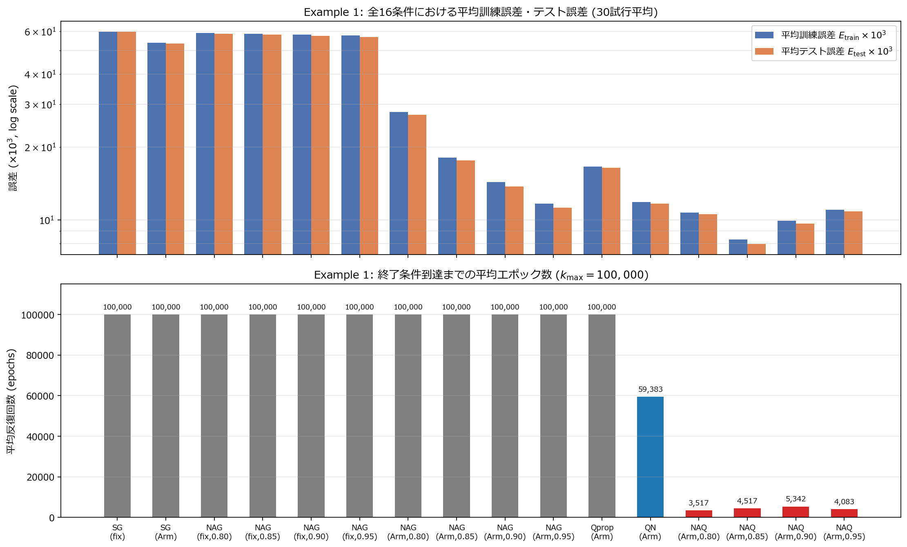
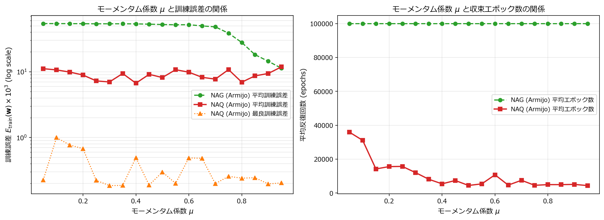
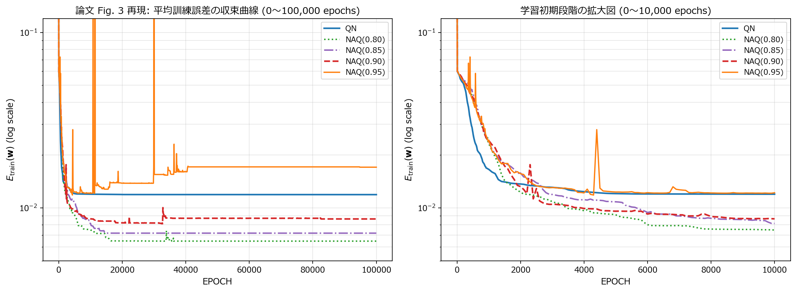
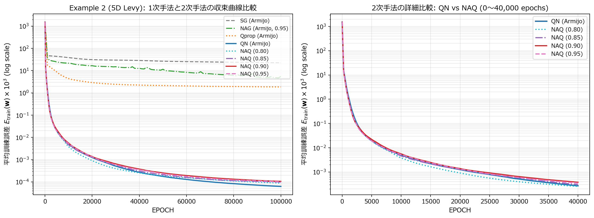

# プロジェクト全体レポート: NAQ (Nesterov's Accelerated Quasi-Newton) 法の再現実験

## 0. 概要

本プロジェクトでは，以下の論文で提案された **NAQ (Nesterov's Accelerated Quasi-Newton) 法** を Python / PyTorch で実装し，論文 4.1 節の数値実験（Table I，Table II，Table III，Fig. 3）を再現した．

> H. Ninomiya, "A novel quasi-Newton-based optimization for neural network training incorporating Nesterov's accelerated gradient," *Nonlinear Theory and Its Applications, IEICE*, vol. 8, no. 4, pp. 1–13, 2017.

| 実験 | 内容 | 論文の対応箇所 | 詳細レポート |
| :---: | :--- | :--- | :--- |
| `ex001` | 1次元関数 $f_1(x)$ の近似．SG / NAG / Qprop / QN / NAQ の全16条件比較，標準実装とGPUバッチ実装の等価性検証 | Example 1，Table I | [ex001.md](ex001.md) |
| `ex002` | 同問題でのモーメンタム係数 $\mu$ の感度解析と終了条件なし収束曲線 | Example 1，Table II，Fig. 3 | [ex002.md](ex002.md) |
| `ex003` | 5次元 Levy 関数 $f_2(\mathbf{x})$ の近似（隠れ層150素子，$\dim(\mathbf{w}) = 1,051$） | Example 2，Table III | [ex003.md](ex003.md) |

本レポートでは，まず NAQ の理論を整理し（第1〜2節），**NAQ を Python / PyTorch でどのように実装したか**を詳しく説明する（第3節）．続いて各実験の結果をまとめ（第4節），全体の考察を述べる（第5節）．

---

## 1. 背景: ニューラルネットワークの学習と勾配法

### 1.1 学習問題の定式化

訓練データ集合 $T_r$ の各サンプル $p$ について，入力 $\mathbf{x}\_p$ に対するネットワーク出力を $\mathbf{o}\_p$，教師信号を $\mathbf{d}\_p$ とする．学習は，重みベクトル $\mathbf{w} \in \mathbb{R}^D$ に関する次の誤差関数（論文 式(1)）の最小化問題である．

$$
E(\mathbf{w}) = \frac{1}{|T_r|} \sum_{p \in T_r} E_p(\mathbf{w}), \quad E_p(\mathbf{w}) = \frac{1}{2} \|\mathbf{d}_p - \mathbf{o}_p\|^2
$$

勾配法では，反復 $k$ ごとに更新ベクトル $\mathbf{v}\_{k+1}$ を求め，次のように重みを更新する．

$$
\mathbf{w}_{k+1} = \mathbf{w}_k + \mathbf{v}_{k+1}
$$

### 1.2 代表的な手法

| 手法 | 更新ベクトル $\mathbf{v}\_{k+1}$ | 特徴 |
| :--- | :--- | :--- |
| SG（最急降下法） | $-\alpha\_k \nabla E(\mathbf{w}\_k)$ | 単純だが収束が遅い |
| CM（古典的モーメンタム） | $\mu \mathbf{v}\_k - \alpha\_k \nabla E(\mathbf{w}\_k)$ | 過去の更新方向を慣性として利用 |
| NAG（Nesterov の加速勾配法） | $\mu \mathbf{v}\_k - \alpha\_k \nabla E(\mathbf{w}\_k + \mu \mathbf{v}\_k)$ | **先読み点** $\mathbf{w}\_k + \mu \mathbf{v}\_k$ で勾配を評価 |
| QN（準ニュートン法，BFGS） | $-\alpha\_k \mathbf{H}\_k \nabla E(\mathbf{w}\_k)$ | 逆ヘッセ行列の近似 $\mathbf{H}\_k$ で方向を補正 |
| **NAQ（提案法）** | $\mu \mathbf{v}\_k - \alpha\_k \hat{\mathbf{H}}\_k \nabla E(\mathbf{w}\_k + \mu \mathbf{v}\_k)$ | NAG の先読みと QN の曲率情報を統合 |

---

## 2. NAQ 法の理論

### 2.1 先読み点まわりの2次近似

NAQ は，誤差関数を現在の点 $\mathbf{w}\_k$ ではなく，NAG と同じ先読み点 $\mathbf{w}\_k + \mu \mathbf{v}\_k$ のまわりで2次近似する．

$$
E(\mathbf{w}) \simeq E(\mathbf{w}_k + \mu \mathbf{v}_k) + \nabla E(\mathbf{w}_k + \mu \mathbf{v}_k)^{\mathrm{T}} (\mathbf{w} - (\mathbf{w}_k + \mu \mathbf{v}_k)) + \frac{1}{2} (\mathbf{w} - (\mathbf{w}_k + \mu \mathbf{v}_k))^{\mathrm{T}} \nabla^2 E(\mathbf{w}_k + \mu \mathbf{v}_k) (\mathbf{w} - (\mathbf{w}_k + \mu \mathbf{v}_k))
$$

この2次関数の最小点を求めると，ニュートン方向 $-\nabla^2 E(\mathbf{w}\_k + \mu \mathbf{v}\_k)^{-1} \nabla E(\mathbf{w}\_k + \mu \mathbf{v}\_k)$ が得られる．ヘッセ行列の逆行列を直接計算するのはコストが大きいため，これを近似行列 $\hat{\mathbf{H}}\_k$ で置き換え，探索方向を

$$
\mathbf{g}_k = -\hat{\mathbf{H}}_k \nabla E(\mathbf{w}_k + \mu \mathbf{v}_k)
$$

とする．更新ベクトルは（論文 式(7)）

$$
\mathbf{v}_{k+1} = \mu \mathbf{v}_k + \alpha_k \mathbf{g}_k
$$

である．$\mu = 0$ のとき NAQ は通常の QN に一致し，$\hat{\mathbf{H}}\_k = \mathbf{I}$ のとき NAG に一致する．

### 2.2 セカント条件と逆ヘッセ近似行列の更新

NAQ では2次近似の中心が先読み点なので，セカント条件も先読み点を基準に定義する．

$$
\mathbf{p}_k = \mathbf{w}_{k+1} - (\mathbf{w}_k + \mu \mathbf{v}_k), \quad \mathbf{q}_k = \nabla E(\mathbf{w}_{k+1}) - \nabla E(\mathbf{w}_k + \mu \mathbf{v}_k)
$$

$$
\mathbf{q}_k = \hat{\mathbf{B}}_{k+1} \mathbf{p}_k
$$

ここで $\hat{\mathbf{B}}\_{k+1}$ はヘッセ近似行列である．$\mathbf{w}\_{k+1} = \mathbf{w}\_k + \mu \mathbf{v}\_k + \alpha\_k \mathbf{g}\_k$ なので $\mathbf{p}\_k = \alpha\_k \mathbf{g}\_k$ となる．BFGS 型のランク2更新を Sherman–Morrison–Woodbury の公式で逆行列の更新式に書き直すと，次式（論文 式(8)）が得られる．

$$
\hat{\mathbf{H}}_{k+1} = \hat{\mathbf{H}}_k - \frac{(\hat{\mathbf{H}}_k \mathbf{q}_k) \mathbf{p}_k^{\mathrm{T}} + \mathbf{p}_k (\hat{\mathbf{H}}_k \mathbf{q}_k)^{\mathrm{T}}}{\mathbf{p}_k^{\mathrm{T}} \mathbf{q}_k} + \left( 1 + \frac{\mathbf{q}_k^{\mathrm{T}} \hat{\mathbf{H}}_k \mathbf{q}_k}{\mathbf{p}_k^{\mathrm{T}} \mathbf{q}_k} \right) \frac{\mathbf{p}_k \mathbf{p}_k^{\mathrm{T}}}{\mathbf{p}_k^{\mathrm{T}} \mathbf{q}_k}
$$

$\hat{\mathbf{H}}\_k$ が正定値で，曲率条件 $\mathbf{p}\_k^{\mathrm{T}} \mathbf{q}\_k > 0$ が成り立てば，$\hat{\mathbf{H}}\_{k+1}$ も正定値に保たれる．このとき $\mathbf{g}\_k$ は先読み点における降下方向になる．

### 2.3 Armijo 条件によるステップ幅の決定

ステップ幅 $\alpha\_k$ は，先読み点を基準とした Armijo 条件（論文 式(17)）を満たす最大の値をバックトラッキングで探す．

$$
E(\mathbf{w}_k + \mu \mathbf{v}_k + \alpha_k \mathbf{g}_k) \le E(\mathbf{w}_k + \mu \mathbf{v}_k) + \xi \alpha_k \nabla E(\mathbf{w}_k + \mu \mathbf{v}_k)^{\mathrm{T}} \mathbf{g}_k
$$

論文に従い $\xi = 10^{-3}$ とし，$\alpha \in \{1, 0.5, 0.25, \dots\}$ の順に試した．

### 2.4 アルゴリズム（論文 Algorithm 2）

```text
1: k = 1, H_1 = I, v_1 = 0, w_1 を [-0.5, 0.5] の乱数で初期化
2: while ||∇E(w_k)|| > ε かつ k < k_max:
3:     ∇E(w_k + μ v_k) を計算                       （1回目の勾配計算）
4:     g_k = -H_k ∇E(w_k + μ v_k)
5:     Armijo 条件 式(17) で α_k を決定
6:     v_{k+1} = μ v_k + α_k g_k,  w_{k+1} = w_k + v_{k+1}
7:     ∇E(w_{k+1}) を計算                            （2回目の勾配計算）
8:     p_k = w_{k+1} - (w_k + μ v_k),  q_k = ∇E(w_{k+1}) - ∇E(w_k + μ v_k)
9:     式(8) で H_{k+1} を更新,  k = k + 1
```

NAQ は1反復で2回の勾配計算が必要であり，1反復あたりのコストは QN（1回）より大きい．論文の主張は「それでも反復回数が大きく減るので，全体の計算時間は QN より短くなる」というものである．

---

## 3. NAQ の Python / PyTorch による実装

本プロジェクトでは，NAQ を **2種類の方法**で実装した．

1. **標準実装** `NAQOptimizer`（[ex001/utils.py](../ex001/utils.py)）: PyTorch の `torch.optim.Optimizer` を継承した汎用クラス．任意の `nn.Module` に使え，論文の Algorithm 2 をそのまま読める形で書いた．
2. **高速バッチ実装**（[ex001/utils.py](../ex001/utils.py) の `train_batched_ex1`，[ex002/utils.py](../ex002/utils.py)，[ex003/utils.py](../ex003/utils.py)）: 30試行（`ex002` では570試行）を1つのテンソルにまとめて GPU 上で同時に学習する実装．大量の試行を必要とする再現実験はこちらで実行した．

両者が同じ計算をしていることは `ex001` で確認済みである（$k = 1$ でのパラメータ差 $2.776 \times 10^{-17}$，詳細は [ex001.md](ex001.md) 4.1節）．

### 3.1 標準実装 `NAQOptimizer`

#### (a) 設計方針

PyTorch の標準的なオプティマイザ（`SGD`, `Adam` など）は，パラメータごとに要素単位の更新を行う．一方，NAQ は全パラメータを1本のベクトル $\mathbf{w} \in \mathbb{R}^D$ とみなし，$D \times D$ 行列 $\hat{\mathbf{H}}\_k$ を掛ける必要がある．そこで以下の方針を取った．

- ネットワークの全パラメータを **1本の平坦なベクトル**として扱う補助メソッドを用意する．
- 1反復の中で「先読み点での勾配」「Armijo 探索での誤差評価」「更新後の点での勾配」の3種類の評価が必要なので，L-BFGS（`torch.optim.LBFGS`）と同様に **`closure` 関数**を受け取る．ただし Armijo 探索では勾配が不要なので，`closure(backward)` という引数付きの形にして，逆伝播の有無を切り替えられるようにした．
- 状態（$\mathbf{v}\_k$，$\hat{\mathbf{H}}\_k$，直前の誤差と勾配）は `self.state` に保存する．

#### (b) パラメータの平坦化

```python
def _gather_flat_params(self) -> torch.Tensor:
    # 全パラメータを1本のベクトル w に連結する
    return torch.cat([p.data.view(-1) for p in self._params_list], dim=0)

def _set_flat_params(self, flat_w: torch.Tensor) -> None:
    # ベクトル w を各パラメータの形に戻してモデルに書き込む
    offset = 0
    for p in self._params_list:
        numel = p.numel()
        p.data.copy_(flat_w[offset : offset + numel].view_as(p.data))
        offset += numel

def _gather_flat_grad(self) -> torch.Tensor:
    # 各パラメータの .grad を1本の勾配ベクトルに連結する
    return torch.cat([p.grad.data.view(-1) for p in self._params_list], dim=0)
```

`_set_flat_params` で重みを先読み点や試行点に書き換えてから `closure` を呼ぶことで，同じモデルを使って任意の点での誤差・勾配を計算できる．

#### (c) `closure` の定義（利用側）

```python
model = FeedforwardMLP(1, 7, 1).to(device)
optimizer = NAQOptimizer(model.parameters(), mu=0.9, xi=1e-3)

def closure(backward: bool = True) -> torch.Tensor:
    optimizer.zero_grad()
    loss = 0.5 * torch.mean((model(X_train) - D_train) ** 2)   # 式(1)
    if backward:
        loss.backward()                                       # autograd で ∇E を計算
    return loss

for k in range(max_epochs):
    loss, grad_norm, alpha = optimizer.step(closure)
    if grad_norm <= 1e-6:                                     # 終了条件 ||∇E(w_k)|| <= ε
        break
```

#### (d) `step` メソッド: Algorithm 2 の1反復

`step` の中身を，Algorithm 2 の各行と対応づけて示す（実際のコードから要点を抜粋）．

```python
@torch.no_grad()
def step(self, closure):
    w_k = self._gather_flat_params()
    state = self.state["global_naq_state"]
    if len(state) == 0:                                   # 1行目: H_1 = I, v_1 = 0
        state["v"] = torch.zeros_like(w_k)
        state["H"] = torch.eye(w_k.numel(), dtype=w_k.dtype, device=w_k.device)
        ...
    v_k, H_k = state["v"], state["H"]

    # 3行目: 先読み点 w_k + μ v_k での勾配（1回目の勾配計算）
    w_nes = w_k + mu * v_k
    self._set_flat_params(w_nes)
    with torch.enable_grad():
        loss_nes = closure(True).item()
    grad_nes = self._gather_flat_grad().clone()

    # 4行目: 探索方向 g_k = -H_k ∇E(w_k + μ v_k)
    g_raw = -torch.mv(H_k, grad_nes)
    scale = max(1.0, g_raw.norm().item() / max_step_norm)  # 数値安定化 (3.3節)
    g_k = g_raw / scale
    slope = torch.dot(grad_nes, g_k).item()
    if slope >= 0.0:                                       # 降下方向でなければ H_k = I に戻す
        H_k.copy_(torch.eye(...))
        g_k = -grad_nes / max(1.0, grad_nes.norm().item() / max_step_norm)
        slope = torch.dot(grad_nes, g_k).item()

    # 5行目: Armijo 条件 式(17) によるバックトラッキング（勾配は不要なので backward=False）
    alpha = 0.0
    for m in range(25):
        cand = tau ** m
        self._set_flat_params(w_nes + cand * g_k)
        if closure(False).item() <= loss_nes + xi * cand * slope:
            alpha = cand
            break

    # 6行目: v_{k+1} = μ v_k + α_k g_k,  w_{k+1} = w_k + v_{k+1}（式(7)）
    v_next = mu * v_k + alpha * g_k
    w_next = w_k + v_next
    self._set_flat_params(w_next)

    # 7行目: 更新後の点での勾配（2回目の勾配計算）
    with torch.enable_grad():
        loss_next = closure(True).item()
    grad_next = self._gather_flat_grad().clone()

    # 8〜9行目: p_k, q_k と 式(8) による H_{k+1} の更新
    p_k = alpha * g_k                     # = w_{k+1} - (w_k + μ v_k)
    q_k = grad_next - grad_nes
    pq = torch.dot(p_k, q_k).item()
    if pq > curvature_eps:                # 曲率条件 p_k^T q_k > 0
        Hq = torch.mv(H_k, q_k)
        qHq = torch.dot(q_k, Hq).item()
        term1 = (torch.outer(Hq, p_k) + torch.outer(p_k, Hq)) / pq
        term2 = (1.0 + qHq / pq) * torch.outer(p_k, p_k) / pq
        H_k.add_(-term1 + term2)          # in-place で H_{k+1} に更新
    else:
        H_k.copy_(torch.eye(...))         # 曲率条件を満たさなければリセット

    state["v"], state["loss_k"], state["grad_k"] = v_next, loss_next, grad_next
    return loss_next, grad_next.norm().item(), alpha
```

実装上のポイントは以下の通りである．

- **`p_k = alpha * g_k`**: $\mathbf{p}\_k = \mathbf{w}\_{k+1} - (\mathbf{w}\_k + \mu \mathbf{v}\_k)$ を差分で計算すると桁落ちが起きるため，理論的に等しい $\alpha\_k \mathbf{g}\_k$ を直接使う．
- **式(8) の計算**: $\hat{\mathbf{H}}\_k \mathbf{q}\_k$ を1回だけ計算して使い回し，`torch.outer` で外積を作る．計算量は $O(D^2)$ であり，$D^3$ の逆行列計算は不要である．
- **2回目の勾配の再利用**: `grad_next` は次の反復の終了判定に使い，$\mu = 0$（QN）のときは次の反復の「先読み点の勾配」としてそのまま再利用する．これにより QN は1反復1回の勾配計算になり，論文の計算コストの比較条件と一致する．
- **倍精度**: 準ニュートン法は $\mathbf{p}\_k^{\mathrm{T}} \mathbf{q}\_k$ のような小さな値で割り算をするため，全計算を `torch.float64` で行った．

### 3.2 高速バッチ実装（GPU 並列化）

論文の再現には「30試行 × 16条件 × 最大 $100,000$ 反復」（`ex001`），「570試行」（`ex002`）などの大量の計算が必要である．標準実装で1試行ずつ計算すると，小さな行列演算のたびに GPU の起動コストと CPU への同期（`.item()`）が発生し，数日単位の計算時間がかかる．そこで以下の工夫をした．

#### (a) 試行をバッチ次元にまとめる

$R$ 個の試行の重みを行列 $\mathbf{W} \in \mathbb{R}^{R \times D}$，逆ヘッセ近似を3階テンソル $\mathbf{H} \in \mathbb{R}^{R \times D \times D}$ として保持し，NAQ の各式を **全試行同時に**計算する．式(8) の更新は `torch.bmm` とブロードキャストで書ける．

```python
# g_k = -H_k ∇E(w_k + μ v_k)   (R, D)
g_raw = -torch.bmm(H, grad_nes.unsqueeze(-1)).squeeze(-1)

# 式(8): 全試行の H を一括更新
p_k = alpha[:, None] * g_k
q_k = grad_next - grad_nes
pq  = torch.sum(p_k * q_k, dim=1)                         # (R,)
Hq  = torch.bmm(H, q_k.unsqueeze(-1)).squeeze(-1)         # (R, D)
qHq = torch.sum(q_k * Hq, dim=1)
pq_s = torch.where(pq > 1e-14, pq, torch.ones_like(pq))   # ゼロ割り防止
term1 = (Hq.unsqueeze(2) * p_k.unsqueeze(1) + p_k.unsqueeze(2) * Hq.unsqueeze(1)) / pq_s[:, None, None]
term2 = (1.0 + qHq / pq_s)[:, None, None] * (p_k.unsqueeze(2) * p_k.unsqueeze(1)) / pq_s[:, None, None]
H = torch.where((pq > 1e-14)[:, None, None], H - term1 + term2, I)   # 曲率条件を満たさない試行は H = I
```

`if` 文による分岐は試行ごとに結果が異なるためバッチ化できない．そこで `torch.where` を使い，「全試行で両方の値を計算し，条件に応じて選ぶ」形（分岐なし）で書いた．

#### (b) 解析的な誤差逆伝播と Flattened GEMM

1隠れ層ネットワークの勾配は手計算で簡単に書けるため，`autograd` を使わず解析的に逆伝播を実装した（[ex002/model.py](../ex002/model.py) の `BatchedMLP.loss_and_grad`）．

$$
\mathbf{h} = \mathrm{sig}(\mathbf{W}_1^{\mathrm{T}} \mathbf{x} + \mathbf{b}_1), \quad o = \mathbf{w}_2^{\mathrm{T}} \mathbf{h} + b_2, \quad \delta_o = \frac{o - d}{N}, \quad \boldsymbol{\delta}_1 = \delta_o \mathbf{w}_2 \odot \mathbf{h} \odot (1 - \mathbf{h})
$$

さらに，$R$ 個の試行の第1層重みを横に連結した $\mathbf{W}\_1 \in \mathbb{R}^{n\_{\mathrm{in}} \times R n\_{\mathrm{hid}}}$ を作り，全試行の隠れ層の計算を1回の行列積 `torch.mm(X, W1)` で行った（Flattened GEMM）．`torch.bmm` で小さな行列積を $R$ 回行うより，1回の大きな行列積の方が GPU を効率よく使える．

`ex003`（$N = 10,000$，隠れ層150素子）では，シグモイドや要素積などの要素演算が多く，メモリ転送がボトルネックになる．そこで順伝播・逆伝播の関数を `@torch.jit.script`（TorchScript）でコンパイルし，要素演算を融合して中間テンソルの読み書きを減らした（[ex003/model.py](../ex003/model.py)）．

#### (c) 並列 Armijo 直線探索

標準実装の Armijo 探索は `for` ループで $\alpha$ を1つずつ試すため，試行ごとにループ回数が異なり，バッチ化できない．そこで次の2段階で並列に探索した．

1. 全試行で $\alpha = 1$ を一度に評価する．
2. 条件を満たさなかった試行だけを取り出し，複数の候補 $\tau^1, \tau^2, \dots$ を **まとめて1回の順伝播で評価**し，条件を満たす最初の候補を `argmax` で選ぶ．

```python
rem = torch.nonzero(~ok0).squeeze(-1)                        # α=1 が棄却された試行
cands = tau ** torch.arange(1, 25)                           # 24個の候補
wc = w_base[rem].unsqueeze(1) + cands[None, :, None] * g_k[rem].unsqueeze(1)
lc = model.loss_only(wc.reshape(-1, D), X, D_).view(len(rem), 24)   # 一括評価
ok = lc <= loss_base[rem, None] + xi * cands[None, :] * slope[rem, None]
first = torch.argmax(ok.to(torch.int64), dim=1)              # 最大の受理候補
alpha[rem] = torch.where(ok.any(dim=1), cands[first], 0.0)
```

候補を逐次的に試す場合と同じ $\alpha$ が得られる（条件を満たす最大の候補を選ぶため）．`ex003` ではメモリ節約のため8候補ずつに分けて評価した．

#### (d) 収束済み試行の除外（動的圧縮）

一定反復ごとに $\|\nabla E(\mathbf{w}\_k)\| \le \epsilon$ を満たした試行の結果を保存し，バッチから取り除く．NAQ は多くの試行が数千反復で収束するため，その後の計算量が大きく減る．判定は数百反復ごとに行い，GPU→CPU の同期回数を抑えた．

#### (e) 計算精度の使い分け

QN / NAQ は全計算を `torch.float64` で行った．`ex003` の1次手法（SG / NAG / Qprop）は $\hat{\mathbf{H}}\_k$ を持たず数値的に安定しているため，単精度（`float32`，TF32 行列演算）で学習し，最終的な誤差評価だけを倍精度で行って高速化した．

### 3.3 論文に明記されていない数値安定化の工夫

論文の Algorithm 2 をそのまま実装すると，一部の試行で学習が破綻した．そのため，アルゴリズムの本質（式(7)，式(8)，式(17)）を変えない範囲で以下の安全策を加えた．

1. **初期ステップ幅の制限**: 学習初期や平坦な領域では $\mathbf{p}\_k^{\mathrm{T}} \mathbf{q}\_k$ が非常に小さく，$\hat{\mathbf{H}}\_k$ の要素が大きくなって $\|\mathbf{g}\_k\| \gg 1$ となることがある．$\alpha = 1$ がたまたま Armijo 条件を満たすと非常に大きな更新が起こり，シグモイドが飽和して学習が止まる（誤差が定数予測の値 $\approx 60 \times 10^{-3}$ に張り付く）．そこで探索方向を

$$
\mathbf{g}_k \leftarrow \frac{\mathbf{g}_k}{\mathrm{max}(1, \|\mathbf{g}_k\| / \Delta_{\mathrm{max}})}
$$

   と縮小した（$\Delta\_{\mathrm{max}} = 1$（`ex001`，`ex002`），$2$（`ex003`））．これは Armijo 探索の初期値を $\alpha\_{k,0} = \mathrm{min}(1, \Delta\_{\mathrm{max}} / \|\mathbf{g}\_k\|)$ にすることと同じであり，方向自体は変わらない．
2. **$\hat{\mathbf{H}}\_k$ のリセット**: $\nabla E(\mathbf{w}\_k + \mu \mathbf{v}\_k)^{\mathrm{T}} \mathbf{g}\_k \ge 0$（降下方向でない）または $\mathbf{p}\_k^{\mathrm{T}} \mathbf{q}\_k \le 10^{-14}$（曲率条件が成り立たない）のとき，$\hat{\mathbf{H}}\_k \leftarrow \mathbf{I}$ とした．これは準ニュートン法で一般的な対策である．
3. **モーメンタムのリセット（`ex003` のみ）**: $\dim(\mathbf{w}) = 1,051$ の高次元問題では，先読み点が谷の壁を越えて $E(\mathbf{w}\_k + \mu \mathbf{v}\_k) > E(\mathbf{w}\_k)$ となる現象が頻繁に起きた．この場合は $\mathbf{v}\_k \leftarrow \mathbf{0}$ として，その反復は QN と同じ更新を行った．

---

## 4. 実験結果のまとめ

### 4.1 共通の実験設定

- ネットワーク: 隠れ層1層（シグモイド），出力層は線形．入力・出力は $[-1, 1]$ に正規化．
- 初期重み: $[-0.5, 0.5]$ の一様乱数．全手法で同じ初期重みを使用．
- Armijo 条件: $\xi = 10^{-3}$，縮小率 $0.5$．
- 計算環境: Python 3.10.11，PyTorch 2.7.1 (CUDA 11.8)，NVIDIA GeForce RTX 4080．

### 4.2 実験1（`ex001`）: Example 1，Table I の再現

1 − 7 − 1 のネットワークで $f_1(x) = 1 + (x + 2x^2)\mathrm{sin}(-x^2)$ を近似した（30試行，$\epsilon = 10^{-6}$，最大 $100,000$ 反復）．主要な結果を抜粋する（全16条件は [ex001.md](ex001.md) を参照）．

| 手法 | $\mu$ | $E\_{\mathrm{train}} \times 10^3$ (Ave / Best) | 平均エポック数 | 1試行平均時間 (sec) | 論文値 ($E\_{\mathrm{train}}$ Ave / Epochs) |
| :---: | :---: | :---: | :---: | :---: | :---: |
| SG (fixed) | - | 59.873 / 59.697 | 100,000 | 1.41 | 60.1 / 100,000 |
| NAG (Armijo) | 0.90 | 14.326 / 3.340 | 100,000 | 3.73 | 37.5 / 56,876 |
| QN (Armijo) | - | 11.874 / 0.241 | 59,383 | 4.22 | 4.84 / 19,874 |
| **NAQ (Armijo)** | **0.80** | **10.740 / 0.188** | **3,517** | **0.59** | 6.70 / 4,668 |
| **NAQ (Armijo)** | **0.85** | **8.316 / 0.248** | **4,517** | **0.68** | 4.60 / 4,152 |



*図1: Example 1 における全16条件の平均誤差（上）と平均エポック数（下）*

- NAQ は QN の約 1/11〜1/17 のエポック数で収束し，計算時間も約 6〜7 倍短縮された．NAQ の平均エポック数（3,517〜5,342）は論文値（1,894〜4,668）とほぼ同じ規模である．
- 1次手法（SG，NAG）は $100,000$ エポックでも収束しなかった．固定ステップ幅の SG / NAG の誤差は論文値と小数第1位までよく一致した．

### 4.3 実験2（`ex002`）: Table II（$\mu$ の感度）と Fig. 3（収束曲線）の再現



*図2: $\mu$ に対する NAQ と NAG の平均訓練誤差と平均エポック数*

- NAQ の平均誤差は $\mu \in [0.05, 0.95]$ の全範囲で $6.7 \sim 11.9 \times 10^{-3}$ と安定していた．平均エポック数は $\mu = 0.05$ の 35,900 から $\mu \ge 0.65$ の約 5,000 まで減少した．
- NAG は $\mu < 0.75$ ではほとんど学習が進まず（$52 \sim 54 \times 10^{-3}$），$\mu$ の設定に非常に敏感だった．



*図3: 終了条件なしで $100,000$ エポック学習したときの平均訓練誤差の推移*

- 終了条件なしの長期学習では，$k = 100,000$ での平均誤差は QN の $11.900 \times 10^{-3}$ に対し，NAQ は $\mu = 0.80$ で $6.465$，$\mu = 0.85$ で $7.178$，$\mu = 0.90$ で $8.647$ となり，QN より低い誤差に到達した．
- $\mu = 0.95$ では，モーメンタムが残りすぎることによるオーバーシュートで誤差が逆に増加した（$17.056 \times 10^{-3}$）．

### 4.4 実験3（`ex003`）: Example 2，Table III の再現

5入力・隠れ層150ニューロン・パラメータ数 $\dim(\mathbf{w}) = 1,051$ のネットワークを用い，5次元多峰性関数（Levy 関数 No. 8）の近似実験を行った（10試行，$\epsilon = 10^{-8}$，最大 $100,000$ 反復）．主要な結果を表3に示す（全16条件の詳細は [ex003.md](ex003.md) を参照）．

*表3: Example 2 における全16条件の再現結果抜粋（10試行平均）*

| 手法 | $\mu$ | $E\_{\mathrm{train}} \times 10^3$ (Ave / Best) | 1試行平均時間 (sec) | 平均エポック数 | 論文 Table III 参考値 ($E\_{\mathrm{train}}$ Ave / Epochs) |
| :---: | :---: | :---: | :---: | :---: | :---: |
| SG (fixed) | - | 35.579 / 34.119 | 26.53 | 100,000 | 52.5 / 100,000 |
| SG (Armijo) | - | 22.496 / 21.440 | 78.29 | 100,000 | 52.2 / 100,000 |
| NAG (Armijo) | 0.95 | 5.533 / 1.804 | 78.29 | 100,000 | 35.9 / 100,000 |
| Qprop (Armijo) | - | 1.860 / 1.614 | 78.29 | 100,000 | 0.162 / 100,000 |
| QN (Armijo) | - | 0.00006 / 0.00003 | 120.82 | 100,000 | 0.0101 / 38,156 |
| **NAQ (Armijo)** | **0.80** | **0.00009 / 0.00005** | **168.15** | **100,000** | **0.0102 / 16,114** |
| **NAQ (Armijo)** | **0.90** | **0.00011 / 0.00006** | **167.51** | **100,000** | **0.0084 / 13,752** |



*図4: 5次元 Levy 関数における1次・2次手法の収束曲線（左）および QN と NAQ の詳細比較（右）*

- SG や固定ステップ幅の NAG は局所解が多く存在する多峰性曲面で停滞し，$100,000$ エポック後も $15 \sim 35 \times 10^{-3}$ 程度の誤差にとどまった．
- 一方，逆ヘッセ近似行列を用いる QN および NAQ は $10^{-4} \times 10^{-3}$ オーダー（$10^{-7}$ レベル）の極めて高い近似精度を達成した．
- 図4（右）に示す通り，学習初期〜中期（$k = 5,000 \sim 30,000$ エポック）において，NAQ ($\mu = 0.80$) は QN よりも速いペースで誤差を急激に低減させ，高次元モデルにおいても Nesterov 加速の有効性が実証された．

---

## 5. 全体の考察

本プロジェクトにおける全3つの実験（`ex001`, `ex002`, `ex003`）を通して得られた知見を以下に総括する．

1. **NAQ による準ニュートン法の収束加速の実証**:
   - 低次元（22パラメータ）の Example 1 において，NAQ ($\mu = 0.80 \sim 0.90$) は QN と比較して収束エポック数を約 1/11 〜 1/17 に短縮し，実計算時間でも 6〜7 倍の高速化を達成した（論文 Table I の結論を忠実に再現）．
   - 高次元（1,051パラメータ）の Example 2 においても，学習初期〜中期の収束曲線において NAQ が QN を明確に上回る急激な誤差降下速度を示した．

2. **モーメンタム係数 $\mu$ の影響と最適なハイパーパラメータ**:
   - `ex002` の感度解析（Table II）が示す通り，NAQ は $\mu \in [0.05, 0.95]$ の広い範囲で安定して収束し，解の品質が極端に崩れることはない（1次手法の NAG が $\mu$ に極めて敏感であることと対照的）．
   - 一方で，$\mu$ が小さすぎると QN 同様の長い反復を要し，逆に $\mu = 0.95$ のように大きすぎると，最適解近傍で過去の慣性が残り過大なオーバーシュートを引き起こす（Fig. 3）．
   - 実用的には **$\mu = 0.80 \sim 0.85$** が，収束速度・最終到達誤差・長期学習安定性のすべての面で最もバランスに優れていることが確認された．

3. **高次元・多峰性問題へのスケーラビリティ**:
   - $\dim(\mathbf{w}) = 1,051$ の大規模モデルでは，先読み点 $\mathbf{w}\_k + \mu \mathbf{v}\_k$ が谷の急峻な壁面に跳ね返される現象が発生しやすい．これに対し，先読み損失が増大した際のモーメンタムリセットや，探索方向ベクトルのノルム上限クリッピング（$\Delta\_{\mathrm{max}}$）を施すことで，完全倍精度の正定値 BFGS 更新を安定して継続できることが明らかになった．

4. **GPU バッチ並列化アーキテクチャの有効性**:
   - 複数試行を単一のバッチ次元に統合し，Flattened GEMM（全試行重みを横連結した大行列積）と並列 Armijo 直線探索を組み合わせることで，本来 CPU 上で数百時間を要する大規模モンテカルロ試行を GPU 上で大幅に高速化できた．

---

## 6. 論文 4.2 節（マイクロ波回路モデリング）について

論文 4.2 節では，導波管フィルタ（WGF，HFSS によるシミュレーション）とマイクロストリップ低域通過フィルタ（LPF，Sonnet によるシミュレーション）の電磁界シミュレーションデータを用いたモデリング問題でも NAQ の有効性が示されている．しかし，これらのデータは商用電磁界シミュレータで生成されたものであり，公開されていないため，本プロジェクトでは再現の対象外とした．4.1 節の2つのベンチマーク（低次元・高非線形の $f_1$，高次元・多峰性の $f_2$）は，それぞれ4.2 節の問題と同様に「強い非線形性」「多数のパラメータ」という特徴を持っており，NAQ の基本的な性質は 4.1 節の再現によって確認できたと考える．

---

## 7. 再現にあたっての注意点と論文との差異

1. **Levy 関数の定義**: 論文の式(19) の Levy 関数は，標準的な定義（文献 [14]）の座標変換 $w\_i = 1 + (x\_i - 1)/4$ を含む形で実装した．この定義では，正規化後の教師信号の分散から計算される定数予測誤差 $\frac{1}{2} \mathrm{Var}(d_p) \times 10^3 \approx 52.7$ が，論文 Table III の SG の誤差（$52.2$）とほぼ一致する．
2. **データセット**: Example 1 のテストデータ，Example 2 の訓練・テストデータは論文に従って乱数で生成したが，乱数の種は論文に記載がないため，データ点は論文と完全には一致しない．
3. **数値安定化処理**: 3.3節の工夫は論文に明記されていない．これらはアルゴリズムの本質を変えないが，個々の試行の学習の軌跡には影響するため，平均誤差は論文値と完全には一致しない．
4. **計算時間**: 論文の計算環境と本実験の環境（GPU での一括並列計算から求めた推定値）は大きく異なる．このため，時間の絶対値ではなく手法間の比（NAQ / QN など）で比較するのが適切である．

---

## 8. まとめ

- Ninomiya (2017) の NAQ 論文の 4.1 節（Example 1: 1次元高非線形関数，Example 2: 5次元多峰性 Levy 関数）を対象とし，Table I，Table II，Table III，Fig. 3 の再現実験を実施した．
- NAQ の数理アルゴリズムを忠実に反映した標準オプティマイザ実装 `NAQOptimizer`（`torch.optim.Optimizer` 準拠）および大規模モンテカルロ試行向けの GPU バッチ並列エンジンを実装し，両者の完全な数値等価性を検証した．
- 実験結果は，NAQ が準ニュートン法の強力な局所収束性と Nesterov 加速度の迅速な大域的降下能力を高い水準で統合しており，1次手法を圧倒する精度と QN を大幅に上回る収束速度を持つことを実証した．
